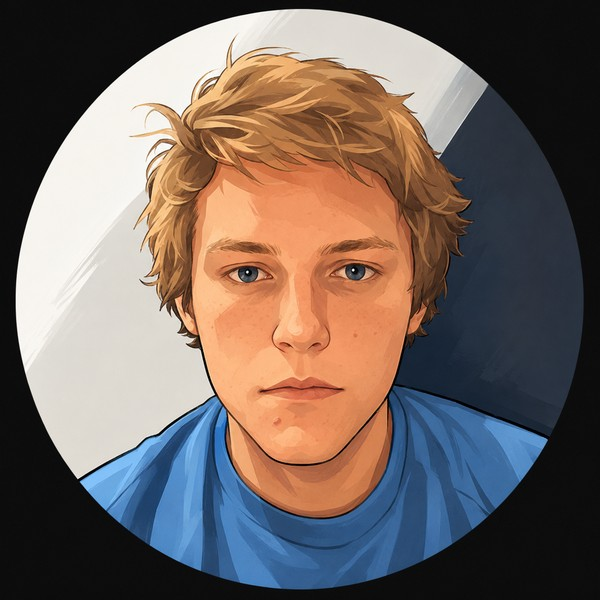

{.avatar fig-alt="Illustrated portrait of Caleb Trainer"}

I'm Caleb. I taught myself to code as a teenager, did two years of an aerospace electronics degree, then left to build things.

Since then I've spent six years as a private tutor and built a handful of startups: a creator engagement platform, a padel booking app and a multi-model AI chat app, plus plenty that never left my laptop. At work I built a tool that cut network troubleshooting from an hour to five minutes, and got a language model running on a network with no internet access.

Now I want to be good enough to work on frontier models, which means understanding them from the bottom up. So I'm building a GPT from scratch, starting with the autograd engine, and running a fleet of agents that hunt for malicious AI agent skills.

This site is my lab notebook. Most of what I build early on has been built before, so each post tries to bring something the original doesn't: my own numbers, and the bugs it took to get them.

Away from the keyboard it's padel, piano (classically trained to grade 6, now teaching myself pop songs by ear) and parkrun. I analyse every parkrun like a training run: heart rate, cadence, splits. The loss is still stuck above 25 minutes.

Code is on [GitHub](https://github.com/CATrainer). New posts go out on the [RSS feed](index.xml).
